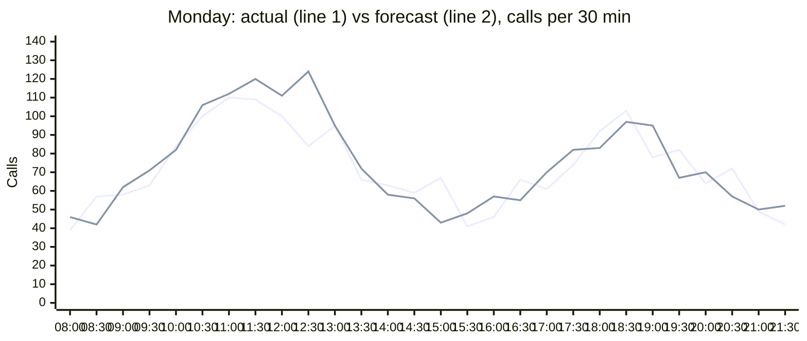
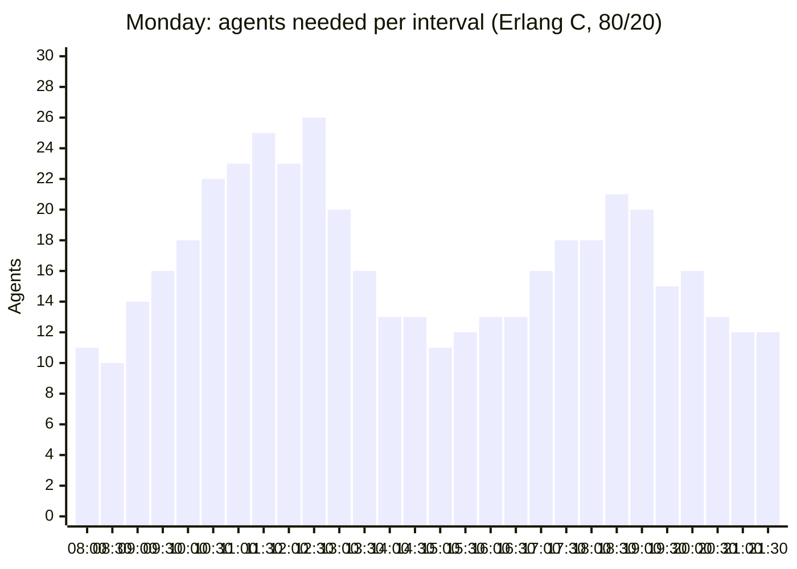
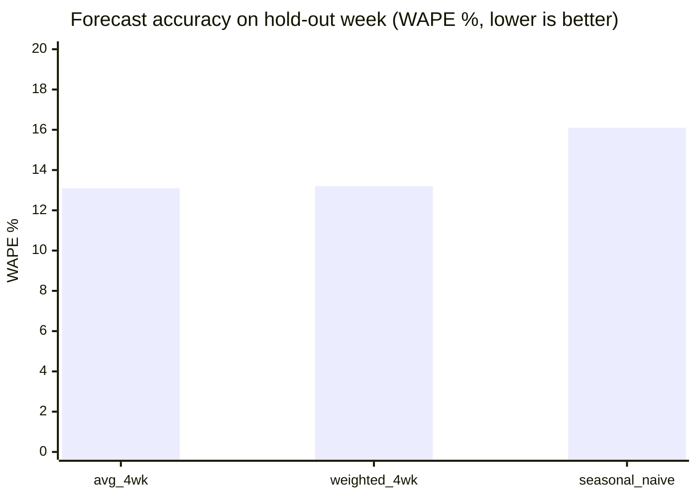

# WFM Forecast → Erlang C Staffing Plan

An end-to-end **workforce management (WFM)** pipeline in Python: forecast interval-level call volume, convert it into required agents with **Erlang C**, apply **shrinkage**, and quantify the trade-offs a capacity planner deals with every week.

> **Data note:** all data is **simulated** (12 weeks of 30-minute intervals with weekly and intraday seasonality, a Monday peak and random noise). No company or customer data is used.





## What it does

| Step | Method |
|---|---|
| 1. Volume history | 13 weeks of simulated 30-min interval volumes, 08:00–22:00 |
| 2. Forecast | Seasonal naive vs 4-week average vs weighted 4-week average, tested on a hold-out week (MAPE, WAPE, bias) |
| 3. Staffing | Erlang C: minimum agents per interval to hit **80% of calls answered in 20 s** (AHT 300 s) |
| 4. Rostered headcount | Required agents ÷ (1 − 30% shrinkage) |
| 5. Trade-offs | Interval vs flat staffing, forecast buffer vs service level, Erlang C scale effect |

## Key findings (on the simulated data)

- **Forecasting:** the 4-week same-weekday average (WAPE **13.1%**) beat seasonal naive (WAPE **16.1%**). Averaging several weeks smooths out one-off noise.
- **Interval staffing pays:** Erlang C staffing interval by interval needs **33% fewer agent-hours** than staffing each day flat at its peak, for the same 80/20 target.
- **Forecast error is a service-level risk:** a plan built exactly on forecast met 80/20 in only **59%** of intervals against actual volume. Adding a **10–15% buffer** lifted that to **77–87%** for **+8–12%** agent-hours. That is the planning-vs-intraday trade-off in numbers.
- **Scale matters (Erlang C is non-linear):** at 10 calls per 30 min the team runs at ~**42%** occupancy; at 200 calls it runs at ~**86%** for the same service level. Small queues are expensive to staff.

Full tables: [`outputs/RESULTS.md`](outputs/RESULTS.md)



## Run it

```bash
pip install -r requirements.txt
python wfm_staffing.py
```

Outputs are written to `outputs/` (CSV staffing plan, accuracy table, charts).

## Skills shown

Forecasting · Erlang C · Service level (80/20) · Shrinkage · Capacity planning · Python (pandas, NumPy, matplotlib)

---
Built by **Rahul**, Control Tower – WFM Analyst. [LinkedIn](https://www.linkedin.com/in/rahul-219543159/)
